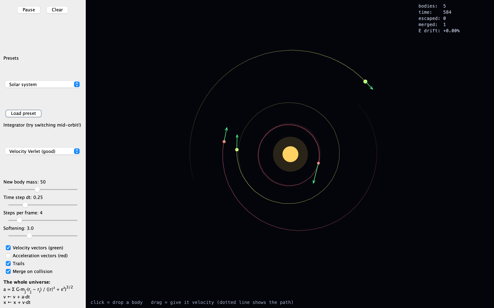

# Gravity Playground

A 2D N-body gravity simulator written in Java (Swing). Click to drop planets, drag to give them velocity, and see whether they orbit or get flung into space.

## Features
- Click and drag to spawn planets, with a dotted line previewing the path
- Velocity and acceleration vectors
- Switch between Euler and Velocity Verlet integration
- Presets: solar system, binary star, figure-eight, chaos cluster
- Live energy-drift readout

## How to run
Requires a JDK (Java 8 or newer).

    javac *.java
    java GravityPlayground

## What I learned
Over 20,000 steps, Velocity Verlet kept total energy within about 0.0002%, while Euler gained about 54%. Small choices in numerical methods change whether an orbit stays stable.
